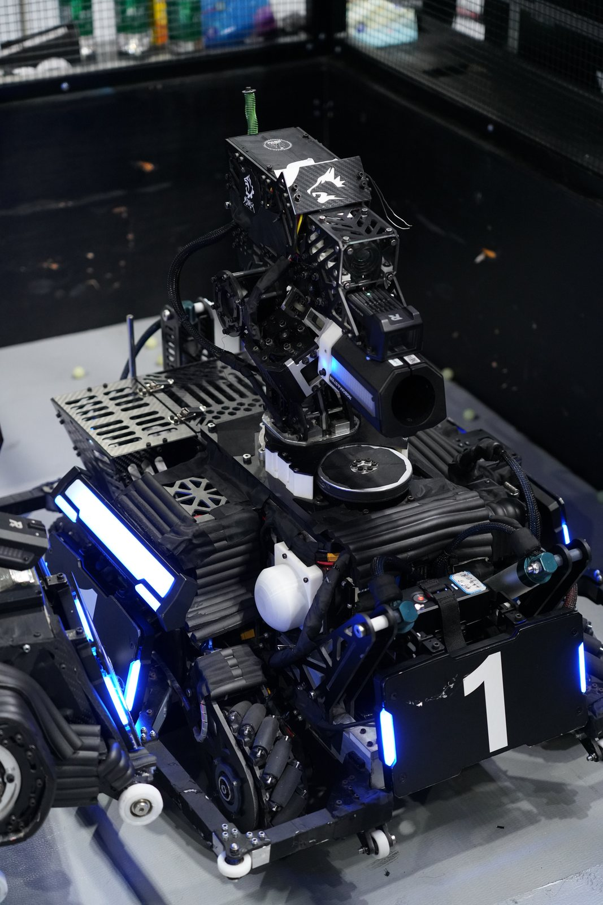
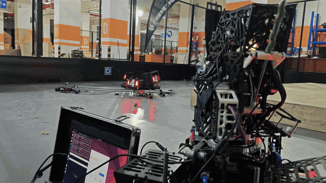
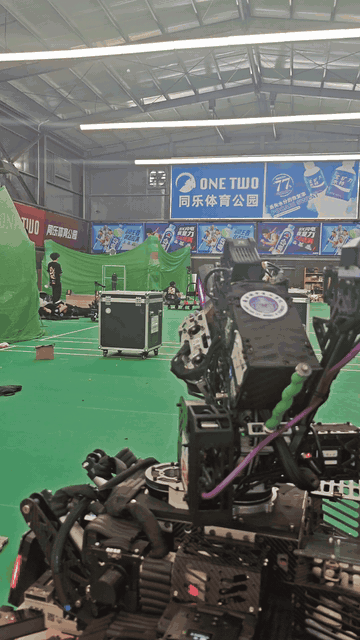
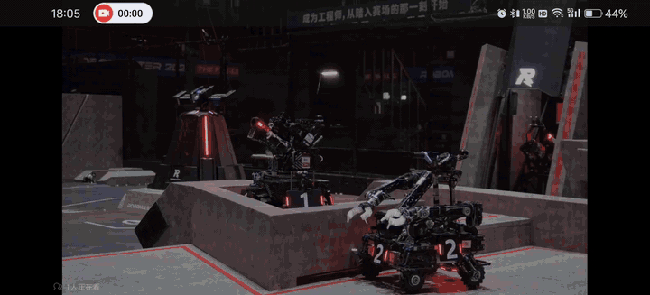
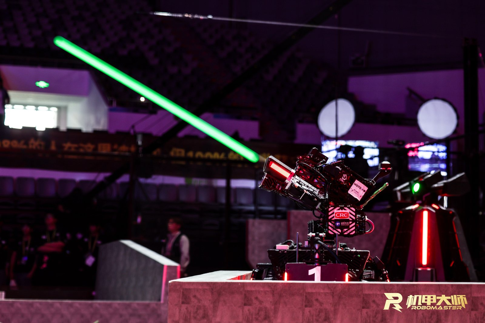
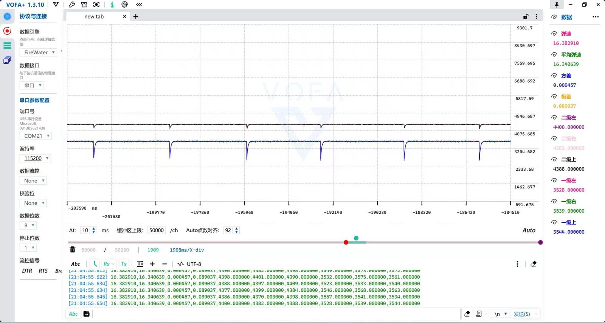

# 26_Hero_Gimbal — RoboMaster 英雄机器人云台板电控

RoboMaster 英雄机器人云台主控板的嵌入式控制程序，覆盖云台双轴、双级六摩擦轮发射、视觉通信和板间协同。

> **版权说明：** Copyright © 2026 Tummmmmmy. All rights reserved. 本仓库仅用于作品展示，未经授权不得复制、修改或再分发。详见 [LICENSE](LICENSE)。

> **项目角色：** 电控负责人，负责整车电控架构、云台板固件、控制闭环与实车联调。<br>
> **本仓库范围：** 云台板固件；底盘板固件见 [26_Hero_Chassis](https://github.com/Tummmmmmy/26_Hero_Chassis)。

<p align="center">
  
</p>

## 项目亮点

- **比赛结果：** RoboMaster 2026 机甲大师超级对抗赛·全国赛 全国一等奖（十二强） | 英雄机器人全国一等奖。
- **国赛统计：** 局均命中 6.5 发，局均关键伤害 1759，双项全国第一。
- **专项实车测试：** 16.5 m/s 发弹初速下，弹速极差 < 0.08 m/s。
- **实时控制：** 双 STM32H723 + FreeRTOS，1 ms 控制周期；本仓库负责云台、发射、视觉通信和板间协同。

## 项目角色与贡献范围

- 本人负责：整车电控架构、云台板固件、CAN 收发与协议、云台/发射控制、视觉与图传链路、参数整定和实车联调。
- 团队协作：视觉识别算法、机械结构与整车硬件加工。
- 仓库保留赛季迭代记录，当前主线代码位于 `Modules/` 与 `Task/`。

## 第三方组件与原创范围

- 仓库包含 STM32 HAL、CMSIS、FreeRTOS、arm_math 等第三方组件；应用层模块、任务组织、CAN 协议、控制逻辑、通信链路和实车调试为本项目工作。
- 外部参考代码和电机/传感器协议实现按其原许可保留，不作为原创部分展示。

## 实车与演示

### 技术演示

<table>
  <tr>
    <td align="center"><br>视觉自瞄与云台跟踪</td>
    <td align="center"><br>22m 远程吊射</td>
  </tr>
</table>

### 比赛高光

<p align="center">
  <br>
  <sub>RoboMaster 2026 全国赛比赛高光</sub>
</p>

<p align="center">
  <br>
  <sub>RoboMaster 2026 机甲大师超级对抗赛·全国赛现场</sub>
</p>

---

## 1. 项目概况

### 硬件平台

| 项目 | 规格 |
|---|---|
| MCU | STM32H723VGT6，Cortex-M7，480 MHz |
| RTOS | FreeRTOS / CMSIS-RTOS v2 |
| 云台 Yaw | 瓴控 MF9025 无刷电机，CAN 力矩控制 |
| 云台 Pitch | 大疆 GM6020 无刷电机，CAN 电流控制 |
| 拨盘 | 达妙 DM-J4340-2EC 关节电机 |
| 摩擦轮 | 大疆 M3508 减速电机 × 6 |
| 图传视角舵机 | RDS3115 双轴舵机，TIM2_CH3 PWM |
| IMU | BMI088，SPI |
| 遥控 | DR16 / VT03 |
| 视觉通信 | USB CDC |
| 电机通信 | FDCAN |

器件型号、CAN 接口和通信链路见 [硬件连接与通信拓扑](docs/hardware-topology.png)。

### 软件环境

- STM32Cube HAL
- FreeRTOS / CMSIS-RTOS v2
- Keil MDK / ARM Compiler 6
- arm_math

---

## 2. 主要功能

### 云台控制

- Yaw / Pitch 双轴控制
- IMU 闭环控制
- 编码器闭环串级 PID
- SMC 滑模控制
- 云台跟随、瞄准等不同控制模式
- 电机掉线与重连处理
- Pitch 角度限制

### 瞄准与视觉

- 手动遥控瞄准
- 视觉自瞄
- 视觉目标角度接收
- IMU 姿态数据发送至视觉端
- USB CDC 通信及数据校验

### 射击系统

- DM4340 拨盘控制
- 6 个摩擦轮速度控制
- 位置 / 速度控制
- 高低速射击模式
- 拨盘自动校位
- 卡弹检测与退弹
- 裁判系统热量数据处理

### 底盘协同

云台板不直接控制底盘电机，而是根据当前模式和操作输入生成底盘控制指令，通过 CAN 发送给底盘主控板。

包括：

- 底盘速度指令
- 云台跟随
- 爬坡模式
- 战斗模式
- 超级电容及相关状态
- 底盘反馈数据解析

---

## 3. 系统结构

整个程序采用基于 FreeRTOS 的任务调度，应用逻辑主要集中在 `Modules/` 中。

```text
                    ┌──────────────────┐
                    │   DR16 / VT03    │
                    └────────┬─────────┘
                             │
                             ▼
┌──────────────┐      ┌──────────────────┐      ┌──────────────┐
│ BMI088 / IMU │─────▶│ Robot_Control    │◀─────│ Vision / USB │
└──────────────┘      │   1 ms Control   │      └──────────────┘
                      └────────┬─────────┘
                               │
                ┌──────────────┼──────────────┐
                ▼              ▼              ▼
        ┌──────────────┐ ┌──────────────┐ ┌──────────────┐
        │Gimbal Control│ │Chassis Control│ │Shooter Control│
        │   SMC / PID  │ │ CAN Command  │ │ PID / State  │
        └──────┬───────┘ └──────┬───────┘ └──────┬───────┘
               │                │                │
               └────────────────┼────────────────┘
                                ▼
                         ┌──────────────┐
                         │    FDCAN     │
                         └──────┬───────┘
                                │
                ┌───────────────┼───────────────┐
                ▼               ▼               ▼
             Yaw / Pitch     Shooter        Chassis Board
```

更完整的软件分层、任务模型和模块职责见 [架构说明](docs/architecture.md)。

---

## 4. 核心控制链路

系统的主要控制循环以约 **1 ms** 为周期运行。

```text
遥控输入 ─────┐
              │
IMU 数据 ─────┼──▶ Robot_Control_Loop()
              │          │
视觉数据 ─────┘          ▼
                    模式判断
                        │
              ┌─────────┼─────────┐
              ▼         ▼         ▼
           云台控制   射击控制   底盘指令
              │         │         │
           SMC/PID   PID/状态机   CAN
              │         │         │
              └─────────┼─────────┘
                        ▼
                       CAN
                        │
                        ▼
                      电机
```

CAN 接收方向则由中断将收到的帧放入消息队列，再由任务完成解析和分发：

```text
FDCAN RX
   ↓
HAL Callback
   ↓
Message Queue
   ↓
CAN Decode Task
   ↓
CAN Receive Router
   ↓
各模块更新电机反馈 / 底盘反馈 / 裁判数据
```

这种方式将 CAN 中断中的工作控制在较小范围内，具体协议解析放到任务中处理。

---

## 5. 通信、实时性与 H7 数据一致性

云台板同时处理视觉、遥控、图传、CAN 和调试遥测，通信链路按“中断只做搬运、任务完成解析、控制环只取最新值”组织。

- **视觉链路：** 通过 USB CDC 与视觉端交换目标角度和 IMU 姿态，应用层使用 CRC16 校验；控制环不直接等待 USB 发送完成。
- **图传链路：** 图传长报文曾阻塞自瞄通信；在分析发送耗时后，将发送改为 UART DMA，并调整任务调度，避免大块数据占用控制任务。
- **H7 D-Cache：** DMA 发送前对发送缓冲区执行 `SCB_CleanDCache_by_Addr`；DR16/VT03 接收回调先执行 `SCB_InvalidateDCache_by_Addr`，再解析数据；DMA 缓冲区按 32 字节对齐，避免 CPU 与 DMA 看到不同副本。
- **非阻塞遥测：** 调试打印由独立任务消费消息队列，发送前 clean cache，DMA 完成中断释放信号量；控制任务不等待串口发送完成。DR16 使用“队列满时覆盖旧帧”的最新值策略，避免旧遥控数据造成处理延迟。

---

## 6. 控制模式

程序根据遥控器输入和机器人状态切换不同工作模式。

| 模式 | 说明 |
|---|---|
| `OFF` | 电机失能 |
| `GIMBAL_ONLY` | 仅控制云台 |
| `CHASSIS_ONLY` | 仅底盘控制 |
| `FOLLOW` | 云台与底盘跟随 |
| `SHOOT / SHOOT_LOW` | 射击模式 |
| `AIMING / M_AIMING` | 视觉 / 手动辅助瞄准 |
| `CLIMB` | 爬坡模式 |
| `BATTLE` | 综合战斗模式 |

实际模式由 `robot_mode` 统一管理，并根据 DR16 / VT03 输入进行映射。

---

## 7. 主要模块

```text
Core/
    STM32 HAL 初始化、main.c、FreeRTOS 配置

Algorithm/
    PID、SMC、姿态解算、滤波、Ramp 等算法

BSP/
    FDCAN、DR16、VT03、DWT、调试协议等底层接口

Devices/
    BMI088、Motor、WS2812、Servo 等设备驱动

Task/
    IMU、控制、CAN、视觉、图传、监控等 FreeRTOS 任务

Modules/
    robot_control
    robot_mode
    gimbal_control
    chassis_control
    shooter_control
    can_receive
    can_transmit
    vision_link
    video_bridge

Drivers/
Middlewares/
    STM32 HAL、CMSIS、FreeRTOS 等第三方/底层组件
```

---

## 8. 云台控制

云台 Yaw 和 Pitch 根据不同比赛模式使用不同的控制方式。

### IMU 模式

使用 IMU 姿态作为反馈，采用 SMC 进行控制。

```text
目标角度
   ↓
角度误差
   ↓
SMC
   ↓
电机控制量
   ↓
CAN
   ↓
云台电机
   ↑
 IMU / 角速度反馈
```

视觉瞄准、基地打击等模式下会根据实际需求调整控制参数。

### 编码器模式

采用位置环 + 速度环串级 PID：

```text
目标角度
   ↓
位置 PID
   ↓
目标速度
   ↓
速度 PID
   ↓
电机控制量
   ↓
CAN
```

两种控制方式根据实际模式切换，用于兼顾不同比赛场景下的响应速度、稳定性和控制方式。

---

## 9. 射击控制

射击系统由拨盘和摩擦轮组成。

```text
                 Shooter Control
                       │
            ┌──────────┴──────────┐
            ▼                     ▼
       DM4340 拨盘             摩擦轮 × 6
       位置 / 速度控制          速度 PID
            │                     │
            └──────────┬──────────┘
                       ▼
                    射击执行
```

拨盘内部包含校位、准备、射击和卡弹处理等状态。

摩擦轮根据射击模式切换目标转速，并通过反馈速度进行闭环控制。

<p align="center">
  <br>
  <sub>弹速采样与调参记录：均值、方差和极差用于评估发弹一致性</sub>
</p>

---

## 10. 安全机制

系统在实际机器人运行中包含多级安全保护：

- 上电默认处于 `OFF` 状态
- IMU 未完成初始化时禁止电机输出
- 遥控器失联后自动进入失能状态
- 电机反馈超时后标记为离线
- Pitch 设置软限位
- 射击系统包含卡弹检测和退弹逻辑
- 复位过程中禁止执行器输出

这些机制主要用于降低上电、通信异常和运行过程中出现失控的风险。


## 11. 工程状态

该工程来自 RoboMaster 赛季实际使用的英雄机器人云台板固件，已经完成实车调试，并在比赛中得到实际验证。

仓库按赛季保留迭代记录，当前主线代码位于 `Modules/` 与 `Task/`。

该仓库主要用于展示机器人嵌入式控制、CAN 通信、实时任务、运动控制以及实车调试相关经验。
